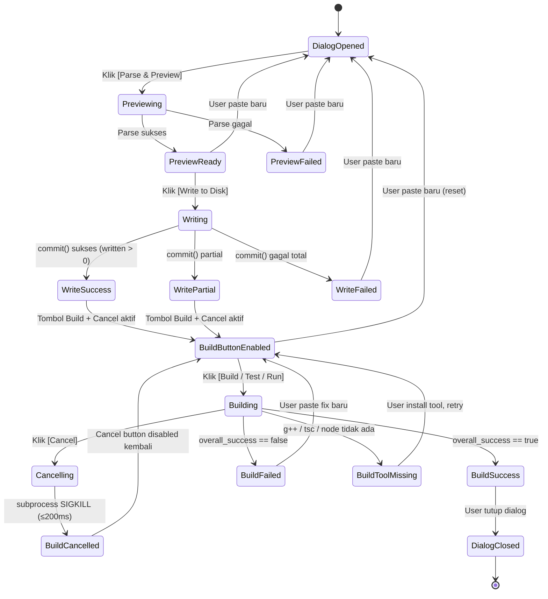
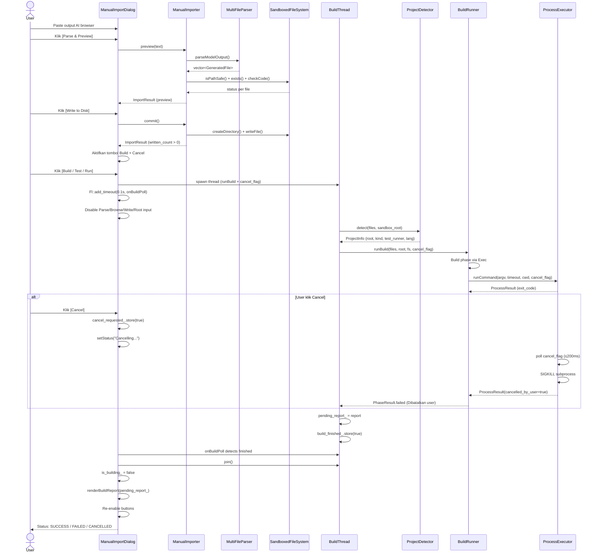
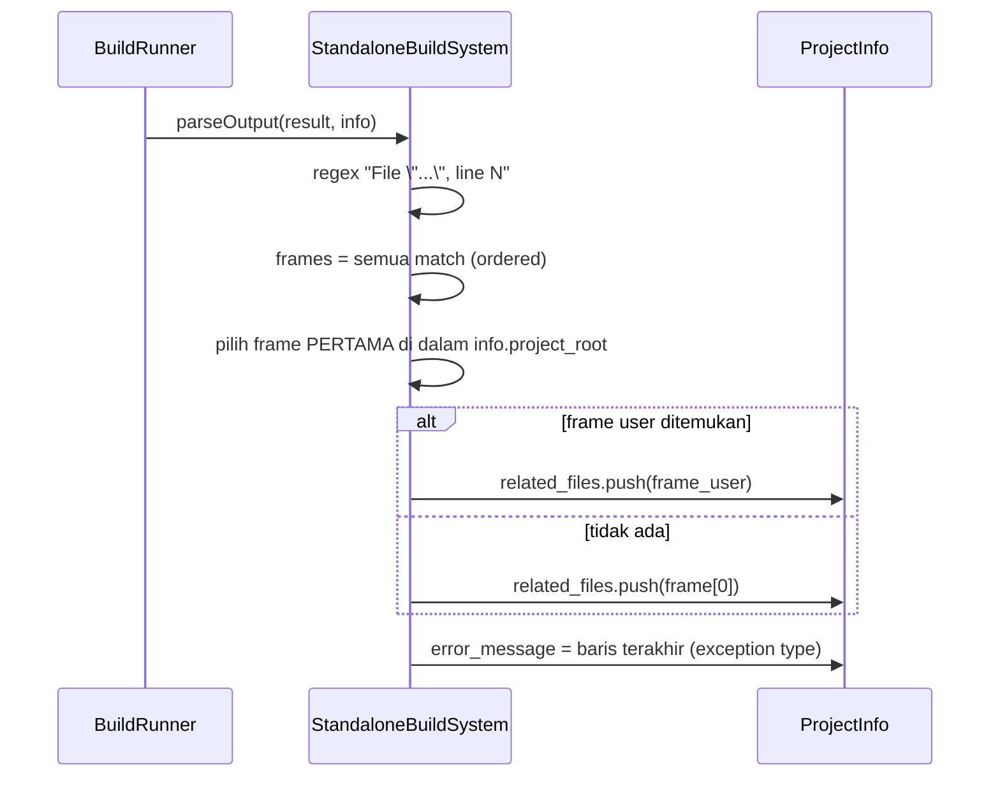

# Blueprint: Frans — AI Code Importer & Build Runner

**Versi**: 2.1 (Revisi pasca-implementasi §9.2 + §9.3 #22–#23 + polish anomali)
**Status**: Workflow inti + prioritas tinggi + prioritas menengah (§9.3 #22, #23) selesai; tinggal polish §9.3 #24–#25 dan test Windows
**Target Platform**: Windows 10/11 + Lubuntu 22.04+ (cross-platform)
**Toolkit**: C++20 + FLTK 1.3 + CMake

---

## 1. Posisi Frans dalam Ecosystem

Frans **BUKAN** aplikasi end-user, dan **BUKAN** AI coding agent. Frans adalah **developer tool** — sama kategorinya dengan VS Code + Continue, tapi niche-nya berbeda: **jembatan antara AI chat browser dan project lokal**.

```
┌─────────────────────────────────────────────────────────────┐
│                WORKFLOW PENGEMBANGAN APLIKASI                │
└─────────────────────────────────────────────────────────────┘

   [Browser AI Chat]         [VS Code + Continue]
   DeepSeek / Gemini /       (untuk editing,
   Claude / ChatGPT           refactoring,
                              debug lokal)
          │                          │
          │ output multi-file        │ edit manual
          │ (File: path + code)      │
          ▼                          ▼
   ┌──────────────────────────────────────────┐
   │              FRANS  (tool ini)           │
   │                                          │
   │  1. Parse output AI browser              │
   │  2. Preview (new/overwrite/blocked)      │
   │  3. Write ke project root (sandboxed)    │
   │  4. Deteksi build system (CMake/npm/...) │
   │  5. Build / Compile                      │
   │  6. Test                                 │
   │  7. Run                                  │
   └──────────────────────────────────────────┘
          │
          ▼
   [Aplikasi Hasil]
```

**Niche Frans** (yang tidak digantikan Continue/Cursor):
- Import output **multi-file** dari AI chat browser (Continue tidak punya ini).
- Preview **sebelum** write (new/overwrite/blocked) — safety layer eksplisit.
- Path normalization dari AI output (`/src/main.py` → `src/main.py`).
- Auto-detect build system dari marker file (CMakeLists.txt, package.json, dll).
- Build → Test → Run pipeline dalam satu klik.

**Sejarah singkat**: Frans v1 (BluePrint-v7) adalah AI coding agent hybrid (local llama.cpp + API berbayar + manual import). Setelah digunakan, agent loop-nya tidak dapat diandalkan — sering merusak kode, tidak terkendali, terlalu banyak bug. Satu-satunya bagian yang terbukti berguna adalah **Stage 11 (Manual Import)** + **Stage 11d (Build & Debug)**. Maka Frans v2 adalah **ekstraksi murni** dari bagian tersebut.

---

## 2. Tujuan & Scope

### 2.1 Tujuan
Satu aplikasi GUI yang mampu:
1. Menerima paste output multi-file dari AI chat browser.
2. Parse menjadi daftar file dengan path + konten.
3. Preview status tiap file (New / Overwrite / Blocked).
4. Menulis file ke project root dengan safety layer.
5. Mendeteksi build system dari marker file.
6. Menjalankan build / test / run.
7. Menampilkan hasil + error dengan file:line reference.

### 2.2 Scope — IN (yang dikerjakan)

| Komponen | Status | Keterangan |
|---|---|---|
| MultiFileParser | ✅ Tervalidasi | Parse `File: path` + fenced block |
| ManualImporter | ✅ Tervalidasi | 2-phase commit (preview + write) |
| SandboxedFileSystem | ✅ Tervalidasi | Cross-platform via `std::filesystem`; path escape + symlink ditolak |
| DangerCheckHandler | ✅ Tervalidasi | Multi-bahasa (Python + Windows patterns); NeedsConfirm bekerja di runtime |
| BuildRunner | ✅ Tervalidasi | Multi-phase: Build → Test → Run; dukung `cancel_flag` + skip parseOutput saat cancel |
| ProjectDetector | ✅ Tervalidasi | Walk-up cari marker; language override dari file aktual |
| BuildSystems (6) | ✅ Tervalidasi | CMake/Make/Meson/npm/Poetry/Standalone |
| ProcessExecutor | ✅ POSIX (termasuk cancel), ⚠️ Win32 belum diuji | Win: CreateProcess, Lin: fork/exec + cancel |
| ManualImportDialog | ✅ Tervalidasi | Standalone, worker thread + Cancel button |
| MainWindow | ✅ Tervalidasi | Sederhana, hanya tombol buka dialog |
| DiffEngine | ✅ Kompilasi, ⚠️ belum dipakai UI | Tersedia untuk preview diff |
| AppConfig | ✅ Tervalidasi | JSON parser minimal (tanpa nlohmann) |
| AppPaths | ✅ Tervalidasi | Resolusi config relatif ke binary (untuk double-click dari file manager) |
| CMake split | ✅ Tervalidasi | 10 file `cmake/*.cmake` |
| Test scenario (`frans_scenarios`) | ✅ 11/11 PASS | FRANS_BUILD_TESTS=ON; mencakup parser, danger, sandbox, traceback picking |

### 2.3 Scope — OUT (yang dibuang total)

| Komponen | Alasan |
|---|---|
| Agent loop (Plan/Generate/Execute/Observe/Fix) | Terbukti tidak dapat diandalkan di v1 |
| ProviderRouter, EscalationPolicy, DailyBudgetGuard | Tidak ada routing AI |
| LlamaCppProvider, DeepSeekProvider, GeminiProvider | Tidak ada AI call |
| tree-sitter, DependencyGraph, ContextSelector | Tidak perlu code intelligence |
| ProjectGraphCache | Tidak ada graph |
| ResourceGuard, IdleUnloadTimer | Tidak ada model lokal |
| SystemMaintenanceFacade | Tidak perlu drop_caches/swap |
| MemoryInfo (/proc/meminfo) | Linux-only, tidak perlu |
| LlamaServerProcessController | Tidak ada llama-server |
| ChatView, LlamaPanel, MaintenancePanel, AgentPanel | UI tidak perlu |
| Worker thread pool kompleks | Hanya 1 worker thread (build) — tidak perlu pool |
| Enrichment related-files via graph | Tidak dibutuhkan saat ini (lihat §11) |

**Estimasi**: ~150 file di v1 → ~40 file di v2 (termasuk test). Binary ~10MB → ~1MB.

---

## 3. Keputusan Arsitektur Kunci

| Keputusan | Alasan |
|---|---|
| **Standalone tool** — tidak ada AI call | Agent loop v1 tidak reliable. Manual Import + Build terbukti berguna. |
| **FLTK, bukan Qt/Electron** | Ringan (~1MB), cross-platform, cukup untuk tool sederhana. |
| **CMake dipecah ke `cmake/*.cmake`** | Lebih mudah dibaca, tanggung jawab per file jelas. |
| **Tidak ada graph/tree-sitter** | Bukan AI agent, tidak perlu code intelligence. |
| **DangerCheckHandler multi-bahasa** | Python + Windows patterns, tetap konservatif. |
| **ProcessExecutor dipecah per platform** | `_posix.cpp` + `_win32.cpp`, dispatcher via `#ifdef`. |
| **AppConfig minimal** | JSON parser inline, hindari dependency nlohmann untuk config flat. |
| **AppPaths: resolusi config relatif ke binary** | Agar bisa di-double-click dari file manager; walk-up dari `exe_dir` max 6 level. |
| **SandboxedFileSystem pakai `std::filesystem`** | Cross-platform by design, tidak ada `#ifdef` di file utama. |
| **2-phase commit** | Preview dulu → user review → baru write. Cegah accidental write. |
| **Path normalization di ManualImporter** | Strip leading `/` (idiom AI), tapi sandbox tetap ketat. |
| **Worker thread + polling (bukan `Fl::lock`)** | Cancel button butuh UI responsif. FLTK tidak thread-safe; polling via `Fl::add_timeout(0.1s)` lebih portable. |
| **Auto `npm install` kalau `node_modules/` tidak ada** | TypeScript butuh `tsc` dari devDependencies. Patch di `NpmBuildSystem::buildCommands()`. |
| **ProjectDetector override language dari file aktual** | Marker `package.json` hardcode "JavaScript"; file `.ts` harus dilaporkan "TypeScript". |
| **Skip `parseOutput` saat cancel** | Subprocess di-SIGKILL → tidak ada error compiler yang valid. Cegah overwrite error_message dengan stdout tail. |
| **Related-files enrichment dihapus** | Tidak dibutuhkan (lihat §11). |

---

## 4. Layer Arsitektur

```
┌──────────────────────────────────────────────────────────┐
│  UI Layer (FLTK)                                         │
│  MainWindow + ManualImportDialog (worker thread + cancel)│
├──────────────────────────────────────────────────────────┤
│  Application Layer                                       │
│  ManualImporter, BuildRunner, ProjectDetector,           │
│  MultiFileParser, DangerCheckHandler                     │
├──────────────────────────────────────────────────────────┤
│  Domain Layer                                            │
│  IFileSystemPort, GeneratedFile, ImportResult,           │
│  BuildReport, ProjectInfo, IBuildSystem                  │
├──────────────────────────────────────────────────────────┤
│  Infrastructure Layer                                    │
│  SandboxedFileSystem, ProcessExecutor (cross-platform),  │
│  DiffEngine                                              │
├──────────────────────────────────────────────────────────┤
│  Config Layer                                            │
│  AppConfig + AppPaths (loader + resolusi lokasi)         │
└──────────────────────────────────────────────────────────┘
```

**Aturan dependensi**: layer atas → layer bawah lewat interface. Domain layer tidak tahu FLTK, tidak tahu OS.

---

## 5. Struktur Folder Final

```
frans/
├── CMakeLists.txt              (tipis, include cmake/*.cmake)
├── CMakePresets.json
├── README.md
├── .gitignore
│
├── cmake/
│   ├── ProjectOptions.cmake    (nama project, versi, C++20, output layout)
│   ├── CompilerWarnings.cmake  (MSVC/GCC/Clang warning flags)
│   ├── Platform.cmake          (dispatcher Windows/Linux)
│   ├── PlatformLinux.cmake
│   ├── PlatformWindows.cmake
│   ├── Dependencies.cmake      (find_package umum)
│   ├── FLTK.cmake
│   ├── Sources.cmake           (daftar file sumber — EDIT DI SINI kalau tambah file)
│   ├── Tests.cmake             (FRANS_BUILD_TESTS=ON, target frans_scenarios)
│   └── Install.cmake
│
├── config/
│   └── app.json
│
├── src/
│   ├── main.cpp
│   │
│   ├── ui/
│   │   ├── MainWindow.cpp/.h
│   │   └── ManualImportDialog.cpp/.h     (worker thread + Cancel button)
│   │
│   ├── application/
│   │   ├── import/
│   │   │   └── MultiFileParser.cpp/.h
│   │   ├── manual_import/
│   │   │   └── ManualImporter.cpp/.h
│   │   ├── safety/
│   │   │   └── DangerCheckHandler.cpp/.h
│   │   └── build_runner/
│   │       ├── BuildRunner.cpp/.h        (cancel_flag)
│   │       ├── ProjectDetector.cpp/.h    (language override)
│   │       ├── BuildReport.h
│   │       ├── ProjectInfo.h
│   │       ├── IBuildSystem.h            (isInsideProject helper)
│   │       └── BuildSystems/
│   │           ├── CMakeBuildSystem.cpp/.h
│   │           ├── MakeBuildSystem.cpp/.h
│   │           ├── MesonBuildSystem.cpp/.h
│   │           ├── NpmBuildSystem.cpp/.h (auto npm install)
│   │           ├── PoetryBuildSystem.cpp/.h
│   │           └── StandaloneBuildSystem.cpp/.h  (traceback frame picking)
│   │
│   ├── domain/
│   │   ├── fs/
│   │   │   └── IFileSystemPort.h
│   │   └── import/
│   │       ├── GeneratedFile.h
│   │       └── ImportResult.h
│   │
│   ├── infrastructure/
│   │   ├── fs/
│   │   │   └── SandboxedFileSystem.cpp/.h
│   │   └── system/
│   │       ├── ProcessExecutor.cpp      (dispatcher)
│   │       ├── ProcessExecutor.h
│   │       ├── ProcessExecutor_posix.cpp
│   │       ├── ProcessExecutor_win32.cpp
│   │       └── DiffEngine.cpp/.h
│   │
│   └── config/
│       ├── AppConfig.cpp/.h
│       └── AppPaths.cpp/.h              (BARU — resolusi config relatif ke binary)
│
└── tests/                               (FRANS_BUILD_TESTS=ON)
    ├── ScenarioTest.cpp                 (frans_scenarios — 11 scenario)
    └── README.md
```

Total: ~40 file (dari ~150 di v1).

---

## 6. Modul Inti

### 6.1 MultiFileParser

**Tugas**: Parse output AI chat → `vector<GeneratedFile>`.

**Format yang dikenali**:
```
File: relative/path.py
[fenced code block]
<content>

File: another.py
[fenced code block]
<content>
```

**Aturan**:
- Marker `File:` case-insensitive, leading whitespace di-toleransi.
- UTF-8 BOM di awal string di-strip.
- Fallback single-file kalau tidak ada marker (butuh `fallback_path`).
- Deterministik, tidak akses filesystem.

**Sudah tervalidasi** dengan 11 scenario di `frans_scenarios`.

### 6.2 ManualImporter

**Tugas**: 2-phase commit.

**Phase 1 — `preview(text)`**:
1. Parse via `MultiFileParser`.
2. Normalize path (strip leading `/`).
3. Validasi: sandbox containment, danger check, new vs overwrite.
4. Return `ImportResult` tanpa menulis.

**Phase 2 — `commit()`**:
1. Untuk setiap file non-Blocked:
   - Auto-create parent directory (idempotent).
   - Snapshot isi lama.
   - Write via `IFileSystemPort`.
2. Reset `has_preview_` supaya commit kedua tidak double-write.

**Sudah tervalidasi**: paste → preview → write → file muncul di disk, termasuk NeedsConfirm (tidak block) dan Blocked (tidak ditulis).

### 6.3 SandboxedFileSystem

**Tugas**: File operations dengan containment check.

**Implementasi**: `std::filesystem::weakly_canonical` + `lexically_relative`. Path yang keluar root ditolak.

**Cross-platform**:
- Path separator: pakai `fs::path` — auto-handle.
- Drive letter (Windows): `lexically_relative()` return empty kalau beda drive → reject.
- Symlink: resolve via `weakly_canonical`.

**Sudah tervalidasi**: `../evil.py`, `../../etc/passwd`, `/etc/passwd`, `src/../../evil.py` semua ditolak. Path aman (`hello.py`, `src/main.cpp`, `a/b/c/d.py`) lolos.

### 6.4 DangerCheckHandler

**Tugas**: Scan kode + command untuk pola berbahaya.

**Verdict**:
- `Safe` — tidak ada pola mencurigakan.
- `NeedsConfirm` — pola berisiko (subprocess, socket) → user konfirmasi.
- `Blocked` — path sistem kritis → ditolak mutlak.

**Pattern Python**: `os.system`, `subprocess.`, `eval(`, `exec(`, `shutil.rmtree`, `socket.socket`, `requests.get`, dll.

**Pattern Windows**: `C:/Windows/System32/config/SAM`, `.../hosts`, `AppData/Local/Microsoft/Credentials`, `reg`, `format`, `diskpart`, `taskkill /f`.

**Command check**: base command (`rm`, `dd`, `mkfs`, `format`, ...), flag (`-rf`, `--no-preserve-root`), argumen path kritis.

**Sudah tervalidasi runtime**: `cleanup.py` (dengan `os.system` + `shutil.rmtree`) → `NeedsConfirm`, tetap di-commit (user-mediated).

### 6.5 ProjectDetector

**Tugas**: Deteksi project root + build system + test runner + primary language.

**Alur**:
1. Walk-up dari setiap file yang di-import ke parent sampai ketemu marker.
2. Vote: project root = path dengan suara terbanyak.
3. Pilih build system dari marker di project root:
   - `CMakeLists.txt` → CMake
   - `meson.build` → Meson
   - `Makefile` / `GNUmakefile` → Make
   - `package.json` → npm
   - `pyproject.toml` → Poetry
   - (tidak ada) → Standalone
4. Deteksi test runner:
   - CMake + `enable_testing`/`add_test` → CTest
   - Makefile + target `test:` → MakeTest
   - Meson → MesonTest
   - package.json + `scripts.test` → NpmTest
   - Poetry + `conftest.py`/`pytest.ini`/`tests/` → Pytest
5. **Language override (baru)**: `detectPrimaryLanguage(files_written)` dijalankan; kalau hasil ≠ `"Unknown"`, override marker language.
   - Marker `package.json` hardcode `"JavaScript"`, tapi file `.ts` → lapor `"TypeScript"`.
   - Marker language tetap dipakai kalau hanya ada file config (tidak ada source).

**Sudah tervalidasi**: CMake + CTest, npm + NpmTest, Standalone + Python/JS.

### 6.6 BuildRunner

**Tugas**: Build → Test → Run pipeline.

**Fase**:
1. **Build**: `system->buildCommands()` → jalankan via `ProcessExecutor`.
2. **Test** (opsional): hanya kalau build sukses + test runner terdeteksi.
3. **Run** (opsional): hanya kalau build + test sukses.

**API** (diperbarui):
```cpp
BuildReport runBuild(
    const std::vector<GeneratedFile>& files_written,
    const std::string& sandbox_root,
    frans::domain::IFileSystemPort& fs,
    int build_timeout_sec = 120,
    int test_timeout_sec  = 120,
    int run_timeout_sec   = 30,
    ConfirmCallback confirm_cb = nullptr,
    std::atomic<bool>* cancel_flag = nullptr);   // BARU
```

**Perubahan**:
- `cancel_flag` diteruskan ke `runPhase()` → `runCommand()`.
- Cek `cancel_flag` sebelum tiap command → skip command berikutnya kalau cancel diminta.
- **Skip `parseOutput` saat cancel**: cegah overwrite `error_message` dengan stdout tail.
- Return awal sebelum label phase di-set → semua phase akan tampil sebagai `[BUILD]`. Sudah di-fix di v2.0 (§9.1 #15).

**Build system matrix**:

| Build System | Marker | Build Command | Test Command | Run Command |
|---|---|---|---|---|
| CMake | `CMakeLists.txt` | `cmake -S . -B build && cmake --build build` | `ctest --test-dir build` | (skip) |
| Make | `Makefile` | `make -jN` | `make test` | (skip) |
| Meson | `meson.build` | `meson setup build && meson compile -C build` | `meson test -C build` | (skip) |
| npm | `package.json` | `npm install` (kalau `node_modules/` belum ada) + `npm run build` (kalau ada) | `npm test` (kalau ada) | (skip) |
| Poetry | `pyproject.toml` | (skip) | `poetry run pytest` | `poetry run python <entry>` |
| Standalone | (tidak ada) | `g++ -std=c++20 ...` / `tsc --noEmit` / `node --check` | pytest (Python) | `python3 <entry>` / `./a.out` / `node <entry>` |

**Error parsing**:
- GCC/Clang: `path:line:col: error: message`
- CMake: `CMake Error at path:line: message`
- Python: `File "path", line N` + exception tail — **pick frame pertama di dalam `project_root`** (bukan stdlib).
- TypeScript: `path(line,col): error TSxxxx: message`
- npm: fallback `npm ERR!` kalau TS error tidak ketemu.

**Sudah tervalidasi**: CMake + CTest, GCC error parser, Python error + traceback frame picking, TS error parser (struktur, belum trigger error), npm install + build + test.

### 6.7 ProcessExecutor

**Tugas**: Jalankan subprocess dengan timeout + cancel, capture stdout/stderr.

**API**:
```cpp
ProcessResult runCommand(
    const std::vector<std::string>& argv,
    int timeout_sec = 30,
    const std::string& stdin_data = {},
    const std::string& working_dir = {},
    std::atomic<bool>* cancel_flag = nullptr);
```

**Implementasi**:
- POSIX: `fork` + `execvp` + pipe non-blocking + `poll` + `SIGKILL` timeout/cancel.
- Win32: `CreateProcess` + `CreatePipe` + `WaitForSingleObject` + `TerminateProcess`.

**Polling interval**: 200ms → latency Cancel ≤200ms.

**Status**: POSIX ✅ (timeout + cancel tervalidasi), Win32 ⚠️ belum diuji.

**Cancel behavior**: `exit_code = 137` (128 + SIGKILL), `cancelled_by_user = true`. `BuildRunner` menerjemahkan ini jadi `[CANCELLED by user]` + error message `Dibatalkan user pada <label>`.

### 6.8 ManualImportDialog

**Tugas**: UI utama untuk import + build + test + run.

**Fitur UI**:
- Input project root + Browse.
- Paste area (`Fl_Text_Editor`).
- Tombol `Parse & Preview`.
- Preview browser (status per file: NEW/OVERWRITE/BLOCKED/CONFIRM).
- Status bar.
- Tombol `Write to Disk`.
- Tombol `Build / Test / Run` + **tombol `Cancel`** (baru).
- Build output area (`Fl_Text_Display`).

**Threading model** (diperbarui):
- Build dijalankan di **worker thread** (`std::thread`) — UI tetap responsif.
- UI **polling** via `Fl::add_timeout(0.1s)` sampai `build_finished_ == true`.
- **Cancel**: tombol set `cancel_requested_ = true`; worker membaca via `cancel_flag` yang diteruskan ke `ProcessExecutor`. Subprocess di-SIGKILL dalam ≤200ms.
- **`confirm_cb` tidak boleh akses FLTK** dari worker. Karena build system command tidak pernah trigger `NeedsConfirm`, worker pakai auto-approve + log ke stderr.
- **Destructor**: kalau worker masih jalan, set `cancel_requested_` + `join()` sebelum `fs_` dihancurkan.

**State machine tombol Build**:
- Disabled saat dialog baru dibuka.
- Disabled saat preview gagal.
- Disabled saat commit gagal / 0 file ditulis.
- Enabled setelah commit sukses.
- Disabled kembali saat paste area dimodifikasi (reset state).
- Disabled **dan diganti label "Building..."** saat build berjalan.

**State machine tombol Cancel**:
- Disabled default.
- Enabled hanya saat `is_building_ == true`.
- Saat diklik: set `cancel_requested_ = true`, status jadi `Cancelling...`.
- Setelah build selesai (cancelled atau tidak): disabled kembali.

**State saat build berjalan** (mencegah race):
- `parse_btn_`, `browse_btn_`, `root_input_`, `write_btn_` semuanya di-deactivate.
- `resetBuildState()` di-skip kalau build sedang jalan.

**Output rendering** (diperbarui):
- Phase `[RUN]` yang sukses menampilkan `stdout` program (mis. `print()` Python, `console.log()` JS).
- Phase `[RUN]` yang gagal menampilkan `stderr` tail.
- Cancel: `[CANCELLED by user]` + error `Dibatalkan user pada <label>`.

**Sudah tervalidasi**: paste → preview → write → build sukses/gagal, Cancel button (SIGKILL), stdout render, traceback frame picking.

### 6.9 MainWindow

**Tugas**: Window utama — tombol buka `ManualImportDialog` + info.

**Layout**: title, deskripsi singkat, input project root, tombol Open Import Dialog, tombol Quit.

**Sudah tervalidasi**: render sempurna di Lubuntu.

### 6.10 AppConfig

**Tugas**: Load `config/app.json`.

**Parser**: Minimal JSON inline (tanpa nlohmann/json). Mendukung:
- String value.
- Integer value.
- Field top-level saja (tidak nested).

**Field**:
- `window_title`, `window_width`, `window_height`, `window_margin_px`.
- `default_project_root`.
- `build_timeout_sec`, `test_timeout_sec`, `run_timeout_sec`.

**Keterbatasan**: nested object tidak diparse. Kalau config berkembang, upgrade ke nlohmann/json.

### 6.11 AppPaths (BARU — §9.2 #20)

**Tugas**: Resolusi lokasi `config/app.json` relatif ke binary, supaya bisa di-double-click dari file manager (CWD tidak reliable).

**API**:
```cpp
namespace frans::config {

// Return direktori executable (via /proc/self/exe di Linux,
// GetModuleFileNameW di Windows).
std::string executableDir();

// Cari config di beberapa lokasi:
//   1. <CWD>/config/app.json               (perilaku terminal lama)
//   2. <exe_dir>/config/app.json           (install bareng binary)
//   3. <exe_dir>/../share/frans/app.json   (install layout Unix)
//   4. Walk-up dari <exe_dir> max 6 level:
//        <exe_dir>/../config/app.json
//        <exe_dir>/../../config/app.json
//        ...
// Return string kosong kalau tidak ada satu pun yang ketemu
// (default di AppConfig tetap dipakai).
std::string findConfigPath(const std::string& argv0);

}
```

**Sudah tervalidasi**: log startup menunjukkan `[frans] config: loaded from /home/farhan/AgenAI/proyek/frans/config/app.json`.

---

## 7. Cross-Platform Strategy

### 7.1 Build System

| OS | Toolchain | FLTK | CMake |
|---|---|---|---|
| Lubuntu | `apt install build-essential cmake libfltk1.3-dev` | System package | System package |
| Windows | MSVC 2022 atau MinGW-w64 | vcpkg atau MSYS2 | System package |

### 7.2 Path Handling

- Internal: selalu pakai `/` (forward slash) via `fs::path::generic_string()`.
- UI: tampilkan path native.
- Comparison: `generic_string()` + lowercase di Windows.
- Drive letter: `lexically_relative()` return empty kalau beda drive → reject.

### 7.3 Line Endings

- AI output bisa `\n` (LF) atau `\r\n` (CRLF).
- Frans tulis dengan line ending native OS via `std::ofstream` + `std::ios::binary`.
- `MultiFileParser` trim trailing newline.

### 7.4 Font & UI

- Font: `FL_HELVETICA` / `FL_COURIER` — tersedia di semua OS.
- File chooser: `fl_dir_chooser()` — native dialog di Windows dan Linux.

### 7.5 Threading

- Hanya **1 worker thread** (build) — tidak ada thread pool.
- Komunikasi UI ↔ worker: `std::atomic<bool>` untuk flag (`build_finished_`, `cancel_requested_`).
- Hasil build ditulis worker ke `pending_report_`, dibaca UI hanya setelah `build_finished_ == true`.
- **UI polling** via `Fl::add_timeout(0.1s)` — tidak pakai `Fl::lock()` (butuh FLTK build dengan threads).

---

## 8. Safety Layer

1. **SandboxedFileSystem** — containment check, path escape ditolak.
2. **DangerCheckHandler** — scan kode + command.
3. **2-Phase Commit** — preview dulu → user review → write.
4. **Timeout** — build/test 120s, run 30s (configurable via `AppConfig`).
5. **Process Isolation** — subprocess dengan cwd = project_root, stdin dari `/dev/null`.
6. **Snapshot before write** — untuk diff/rollback manual (in-memory saja, tidak otomatis).
7. **Cancel** — user-initiated SIGKILL (POSIX) / `TerminateProcess` (Win32), latency ≤200ms.
8. **Worker thread isolation** — `confirm_cb` tidak boleh akses FLTK dari worker; auto-approve + log untuk command build system.

---

## 9. Roadmap Implementasi

### 9.1 Selesai ✅

| # | Item | Status |
|---|---|---|
| 1 | Ekstraksi struktur folder (dari ~150 file → ~40 file) | ✅ |
| 2 | CMake split ke 10 file `cmake/*.cmake` | ✅ |
| 3 | `MultiFileParser` + `ManualImporter` + `SandboxedFileSystem` | ✅ |
| 4 | `DangerCheckHandler` (Python + Windows patterns) | ✅ |
| 5 | `ProcessExecutor_posix.cpp` (dari v1) | ✅ |
| 6 | `ProcessExecutor_win32.cpp` (baru, belum diuji) | ⚠️ |
| 7 | `ProjectDetector` + 6 BuildSystem | ✅ |
| 8 | `BuildRunner` multi-phase | ✅ |
| 9 | `ManualImportDialog` (standalone, tanpa AppContext) | ✅ |
| 10 | `MainWindow` + `main.cpp` + `AppConfig` | ✅ |
| 11 | Build sukses di Lubuntu | ✅ |
| 12 | Validasi: paste CMake multi-file → build → test sukses | ✅ |
| 13 | Validasi: error parser GCC (`file:line:col`) | ✅ |
| 14 | Bug fix: `Fl_Input` forward declaration di namespace | ✅ |
| 15 | Bug fix: label phase `[TEST]`/`[RUN]` tampil sebagai `[BUILD]` | ✅ |
| 16 | Test Python standalone (paste `.py` → Standalone → `python3`) | ✅ |
| 17 | Test paste output AI browser asli (prose + multi-file) | ✅ |
| 18 | Test path escape (`../evil.py` → BLOCKED) | ✅ |
| 19 | Test danger pattern (`os.system`, `shutil.rmtree` → CONFIRM) | ✅ |
| 20 | Resolve path config relatif ke binary (`AppPaths`) | ✅ |
| 22 | Test project npm + TypeScript + JavaScript | ✅ (Poetry skip) |
| 23 | Cancel button + worker thread + test cancel | ✅ |
| 24 | Bug fix: traceback frame picking (pilih frame user, bukan stdlib) | ✅ |
| 25 | Stdout program tampil di phase `[RUN]` yang sukses | ✅ |
| 26 | Bug fix: error message saat cancel (`Dibatalkan user`, bukan stdout tail) | ✅ |
| 27 | ProjectDetector language override (TS tidak lagi lapor "JavaScript") | ✅ |
| 28 | NpmBuildSystem auto `npm install` kalau `node_modules/` belum ada | ✅ |
| 29 | Test scenario runner `frans_scenarios` (11/11 PASS) | ✅ |

### 9.2 Berikutnya — Prioritas Tinggi (sisa)

| # | Item | Keterangan | Status |
|---|---|---|---|
| 21 | Test di Windows 10 | Compile & run, terutama `ProcessExecutor_win32.cpp` — cancel + timeout | ⏸️ butuh environment Windows |

**Catatan**: #21 adalah satu-satunya item prioritas tinggi yang tersisa. Tidak bisa dikerjakan di Lubuntu; butuh akses ke Windows 10/11 + MSVC 2022 atau MinGW-w64.

### 9.3 Berikutnya — Prioritas Menengah (sisa)

| # | Item | Keterangan | Status |
|---|---|---|---|
| 24 | `.desktop` file (Linux) + shortcut Windows | Setelah config path di-patch (#20 selesai) | ✅ |
| 25 | Install target: `sudo cmake --install build --prefix /usr/local` | `cmake/Install.cmake` sudah ada; perlu verifikasi + dokumentasi | ⏳ next |

**Catatan**: #24 dan #25 bisa dikerjakan sekaligus (batch polish kecil). Setelah itu §9.3 selesai.

### 9.4 Berikutnya — Prioritas Rendah (Polish)

| # | Item | Keterangan |
|---|---|---|
| 26 | `tests/*.cpp` (unit test formal) + `cmake/Tests.cmake` | Saat ini hanya scenario test; unit test untuk regresi |
| 27 | Diff view sebelum Write | Pakai `DiffEngine` yang sudah ada |
| 28 | Keyboard shortcut (`Ctrl+V`, `Esc`) | UX polish |
| 29 | Refresh preview button | UX polish |
| 30 | Recent project roots | Dari `config/app.json` |
| 31 | Icon aplikasi | Branding |
| 32 | `README.md` proper | Dokumentasi build + usage |
| 33 | Upgrade `AppConfig` ke nlohmann/json | Kalau config berkembang |
| 34 | Enrichment related-files via graph | **Tidak akan dikerjakan** (lihat §11) |
| 35 | Diff view + rollback otomatis dari snapshot | Saat ini snapshot in-memory, tidak ada UI rollback |
| 36 | Poetry test (butuh install `poetry` di sistem) | Skip untuk sekarang |

### 9.5 Distribusi

Karena ini **personal use**:
- **Tidak ada packaging** (tidak ada installer, tidak ada AppImage, tidak ada .deb).
- **Cara pakai**: `git clone` di Windows/Lubuntu, `cmake`, `cmake --build`, jalankan binary.
- **Tidak akan dipublikasikan** ke package manager atau release GitHub.

---

## 10. Keputusan yang Sudah Diambil

### 10.1 Enrichment related-files via graph

**Keputusan**: **Tidak dibutuhkan saat ini.**

**Alasan**:
- Frans v2 bukan AI agent — hanya importer + build runner.
- `DependencyGraph` (v1) membutuhkan tree-sitter + grammar per bahasa (~4 grammar) → menambah ~200 MB ke repo + binary size signifikan.
- Enrichment hanya berguna kalau error di satu file berdampak ke file lain. Untuk project <1000 file, user bisa cari sendiri via grep.
- Error parser sudah menampilkan file:line — cukup untuk fix lokal.

**Status**: Dihapus dari struktur. Kalau nanti berubah pikiran, butuh rebuild besar (tree-sitter + graph). Tidak ada rencana.

### 10.2 Distribusi

**Keputusan**: **Personal use, git clone + build.**

**Alasan**:
- Target user: 1 orang (diri sendiri).
- Cross-platform via `git clone` di kedua OS + `cmake` + `cmake --build`.
- Tidak ada installer, tidak ada release binary.

**Cara pakai**:
```bash
# Lubuntu
git clone <repo> frans
cd frans
cmake -S . -B build
cmake --build build -j
./build/bin/frans

# Windows (MSVC)
git clone <repo> frans
cd frans
cmake -S . -B build -G "Visual Studio 17 2022" -A x64
cmake --build build --config Release
build\bin\Release\frans.exe
```

### 10.3 Nama aplikasi

**Keputusan**: **Frans** (dikonfirmasi).

**Alasan**:
- Singkat, mudah diingat.
- Konsisten dengan v1 (`frans_ai`).
- Binary name: `frans` (Linux), `frans.exe` (Windows).
- Window title: `Frans — AI Code Importer & Build Runner`.

### 10.4 Worker thread vs `Fl::lock()`

**Keputusan**: **Worker thread + polling via `Fl::add_timeout(0.1s)`.**

**Alasan**:
- Cancel button butuh UI responsif selama build berjalan.
- `Fl::lock()` membutuhkan FLTK di-build dengan `--enable-threads`, tidak selalu tersedia di distro (Lubuntu default OK, tapi tidak portable).
- Polling 100ms cukup responsif untuk human interaction, dan menghindari race condition yang kompleks.
- Cancel latency = polling interval `ProcessExecutor` (200ms), bukan UI polling (100ms).

### 10.5 Auto `npm install`

**Keputusan**: **Jalankan `npm install` otomatis kalau `node_modules/` belum ada.**

**Alasan**:
- TypeScript (`tsc`) di-install sebagai `devDependencies`, tidak global.
- User yang paste dari AI tidak selalu punya `node_modules/` di project root.
- `NpmBuildSystem::buildCommands()` cek `fs.exists("node_modules")` → prepend `npm install` kalau belum ada.
- `--no-audit --no-fund` supaya output tidak noise dan cepat.

### 10.6 ProjectDetector language override

**Keputusan**: **Override `primary_language` dari marker dengan `detectPrimaryLanguage(files_written)` kalau ≠ `"Unknown"`.**

**Alasan**:
- Marker `package.json` hardcode `"JavaScript"`, tapi project bisa berisi `.ts`.
- Marker `pyproject.toml` hardcode `"Python"`, benar untuk Poetry.
- Marker `CMakeLists.txt` hardcode `"C++"`, tapi project CMake bisa mixed C/C++.
- File aktual yang di-import adalah sumber kebenaran yang lebih akurat.
- Marker language tetap dipakai sebagai fallback kalau hanya ada file config (mis. `package.json` doang tanpa source).

---

## 11. Yang Tidak Akan Dikerjakan

| Komponen | Alasan |
|---|---|
| Enrichment related-files via graph | Tidak dibutuhkan; butuh tree-sitter (~200 MB) |
| Installer / AppImage / .deb | Personal use, git clone cukup |
| AI provider (DeepSeek/Gemini/llama) | Fokus pada import + build saja |
| Agent loop | Terbukti tidak reliable di v1 |
| RAG embedding | Tidak cocok untuk coding agent (lihat v1 §9) |
| Publish ke GitHub Releases | Personal use |
| Poetry test | Butuh install `poetry` di sistem; skip kecuali diminta |

---

## 12. Risiko & Mitigasi

| Risiko | Impact | Mitigasi |
|---|---|---|
| `ProcessExecutor_win32.cpp` buggy | High | Test ekstensif di Windows sebelum dipakai produktif |
| Path handling edge case (symlink, junction, UNC) | Medium | `weakly_canonical` + test kasus edge |
| Build system detection salah | Medium | User bisa ubah project root manual via UI |
| DangerCheckHandler false positive | Low | Pattern list konservatif, `NeedsConfirm` tidak block |
| Config tidak ketemu saat double-click | Low | Sudah di-patch via `AppPaths` (§9.1 #20) |
| Paste dari AI browser tidak terdeteksi multi-file | Low | Parser toleran leading whitespace; log diagnostic ke stderr |
| `confirm_cb` akses FLTK dari worker | Medium | Auto-approve + log; build system command tidak pernah NeedsConfirm |
| `npm install` timeout untuk package besar | Medium | Timeout 120s; user bisa klik Cancel atau naikkan config |

---

## 13. Success Criteria

Frans v2 dianggap sukses kalau:
1. ✅ Bisa import output multi-file dari DeepSeek Chat browser.
2. ✅ Preview menunjukkan status New/Overwrite/Blocked dengan benar.
3. ✅ Write ke project root dengan safety layer.
4. ✅ Deteksi build system dari marker file.
5. ✅ Build → Test → Run pipeline berjalan.
6. ✅ Error ditampilkan dengan file:line reference.
7. ⚠️ Berjalan di Windows 10/11 dan Lubuntu 22.04+ (Win belum diuji).
8. ✅ Binary size < 5MB.
9. ✅ Startup time < 1 detik.
10. ✅ Tidak ada dependency ke AI API / model lokal.
11. ✅ Test scenario otomatis (11/11 PASS).
12. ✅ Cancel button bekerja (SIGKILL dalam ≤200ms).
13. ✅ Config path resolve relatif ke binary (bisa di-double-click).

---

## 14. Catatan Operasional

- **Bisa dijalankan dari terminal atau double-click** (§9.1 #20 selesai) — log `[frans][...]` tetap muncul di stderr terminal kalau dijalankan dari sana.
- **Log prefix**:
  - `[frans]` — umum (startup, runCommand).
  - `[frans][sandbox]` — sandbox operations.
  - `[frans][manual_import]` — parser + commit.
  - `[frans][manual_import_dialog]` — reset state, cancel request.
  - `[frans][project_detector]` — deteksi project.
  - `[frans][build_runner]` — build phase.
- **Cek paste multi-file**: `grep "^File:" file.txt` — marker harus di kolom 0.
- **Kalau build command diblokir**: cek `[frans][build_runner] ... BLOCKED`.
- **Kalau build menggantung**: klik `Cancel` di UI — subprocess di-SIGKILL dalam ≤200ms.
- **Build test**: `cmake -S . -B build -DFRANS_BUILD_TESTS=ON && cmake --build build -j`, lalu `./build/bin/frans_scenarios`.
- **Jangan panggil `drop_caches`** — tidak relevan di v2 (tidak ada llama.cpp).

---

## 15. Diagram

### State Diagram (ManualImportDialog)



### Sequence Diagram (Manual Import + Build/Debug + Cancel)



### Sequence Diagram (Error Parser — Traceback Frame Picking)



---

## 16. Changelog v2.0 → v2.1

Revisi pasca-implementasi §9.2 (Prioritas Tinggi) + §9.3 #22–#23 + polish anomali.

### Ditambahkan

- `src/config/AppPaths.h/.cpp` — resolusi `config/app.json` relatif ke binary.
- `tests/ScenarioTest.cpp` + `tests/README.md` — scenario runner `frans_scenarios`.
- `cmake/Tests.cmake` — target `frans_scenarios` + `FRANS_BUILD_TESTS=ON`.
- Cancel button di `ManualImportDialog` + worker thread.
- `BuildRunner::runBuild(...)` parameter `cancel_flag`.
- `IBuildSystem::isInsideProject()` helper untuk error parser.
- `NpmBuildSystem::relProjectToSandbox()` + `packageJsonHasField()`.
- Auto `npm install` kalau `node_modules/` belum ada.
- ProjectDetector language override dari file aktual.

### Diubah

- `main.cpp` — pakai `findConfigPath(argv0)` sebelum `AppConfig::loadFromFile`.
- `ManualImportDialog` — build di worker thread; UI polling via `Fl::add_timeout`.
- `ManualImportDialog::formatPhase()` — render `stdout` saat phase Run sukses.
- `StandaloneBuildSystem::parseOutput` — pilih frame Python PERTAMA di dalam project_root.
- `PoetryBuildSystem::parseOutput` — patch serupa.
- `BuildRunner::runPhase` — skip `parseOutput` saat cancel.
- `ProjectDetector::detect` — override `primary_language` dari `detectPrimaryLanguage`.

### Bug fix

- Cancel: error message tidak lagi overwrite dengan stdout tail (`Dibatalkan user pada run`).
- TS project terdeteksi `TypeScript` (bukan lagi `JavaScript`).
- Traceback frame: related_files menunjuk `cleanup.py:9` (bukan `shutil.py:773`).
- Phase `[RUN]` sukses menampilkan `stdout` (sebelumnya kosong).

### Ditunda / Skip

- `ProcessExecutor_win32.cpp` test di Windows (§9.2 #21).
- Poetry test (butuh `poetry` di sistem).

---

## 17. Referensi Cepat

### Menjalankan

```bash
# Build + test
cmake -S . -B build -DCMAKE_BUILD_TYPE=Release -DFRANS_BUILD_TESTS=ON
cmake --build build -j

# GUI
./build/bin/frans

# Test scenario (11/11 PASS diharapkan)
./build/bin/frans_scenarios

# Lihat daftar scenario
./build/bin/frans_scenarios --list

# Dump scenario paste-ready ke stdout
./build/bin/frans_scenarios --dump npm-typescript
```

### Setup test project

```bash
# Python standalone
rm -rf /tmp/frans_pytest && mkdir -p /tmp/frans_pytest

# Cancel test (sleep 60)
rm -rf /tmp/frans_cancel && mkdir -p /tmp/frans_cancel

# npm / TS
rm -rf /tmp/frans_npm_basic && mkdir -p /tmp/frans_npm_basic
rm -rf /tmp/frans_npm_ts    && mkdir -p /tmp/frans_npm_ts

# JS standalone
rm -rf /tmp/frans_js && mkdir -p /tmp/frans_js
```

### Environment (Lubuntu 24.04, terverifikasi)

| Tool | Versi |
|---|---|
| g++ | 13.3.0 |
| Python | 3.12.3 |
| node | v24.7.0 |
| npm | 11.5.1 |
| FLTK | 1.3.8 |
| CMake | ≥ 3.16 |

Poetry: **tidak terinstall** — skip test Poetry.

---
